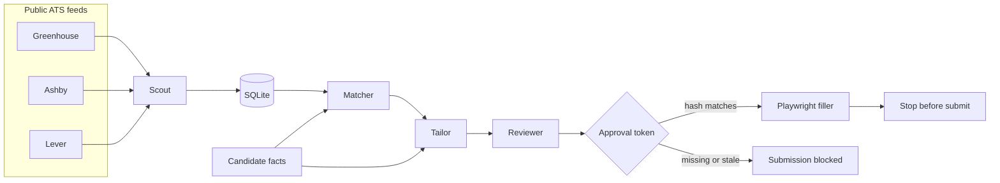
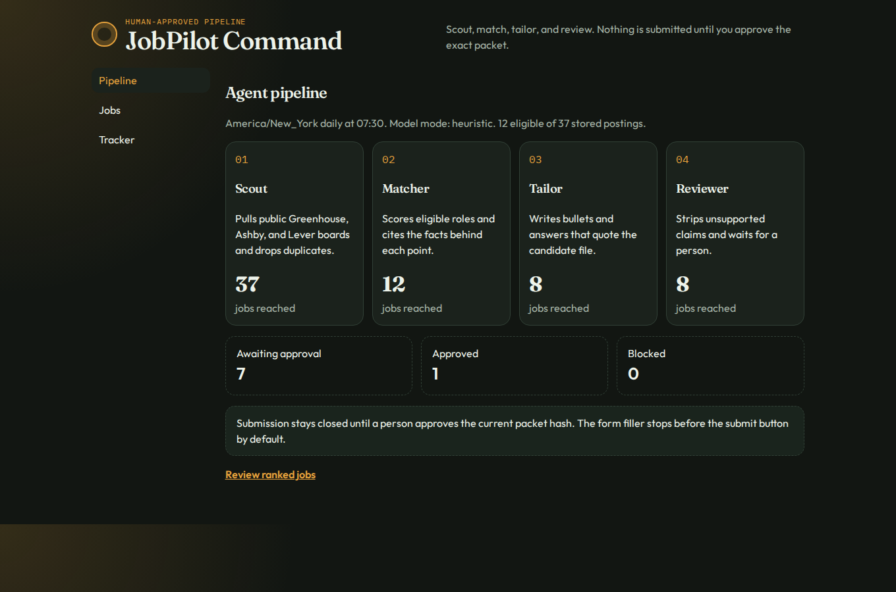
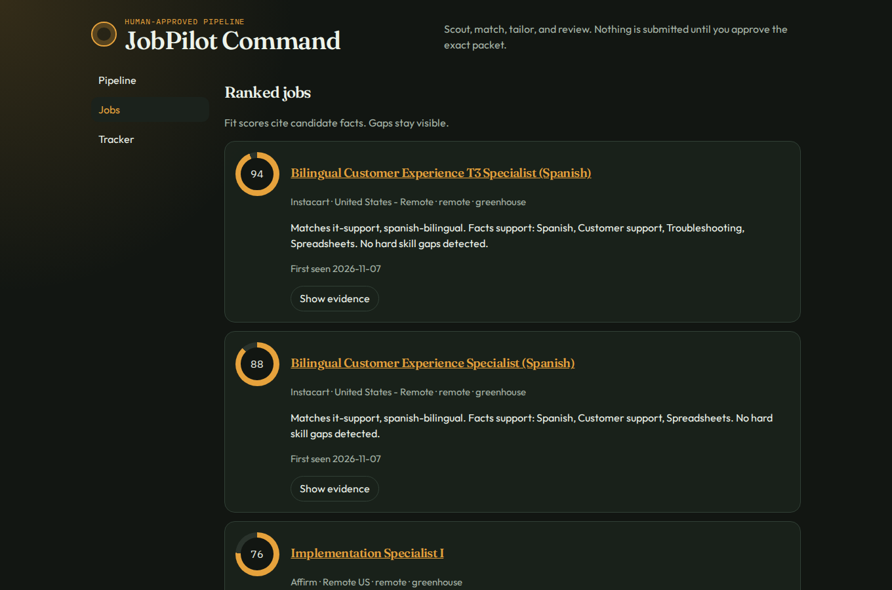
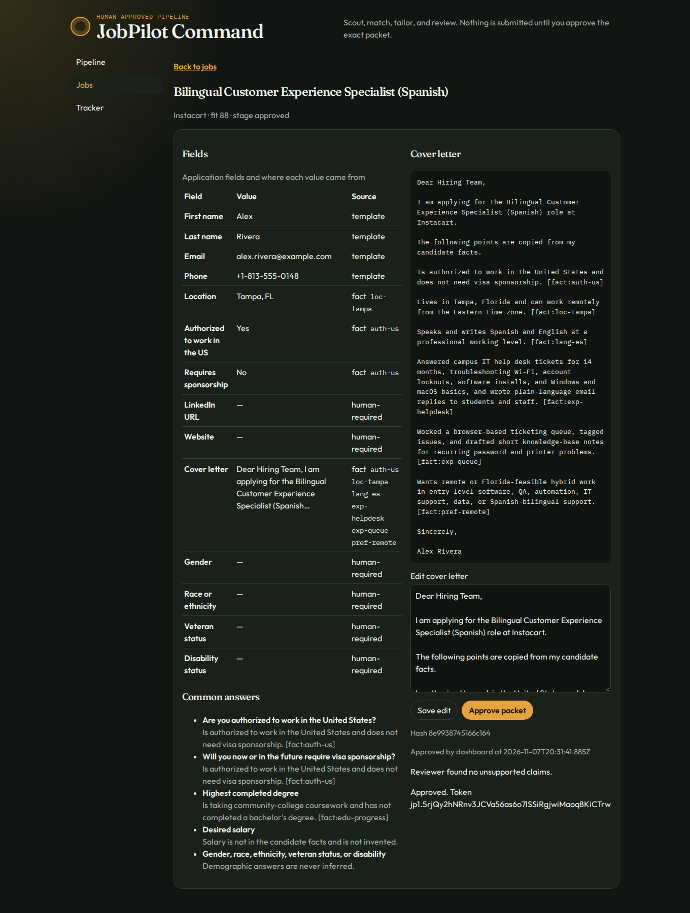
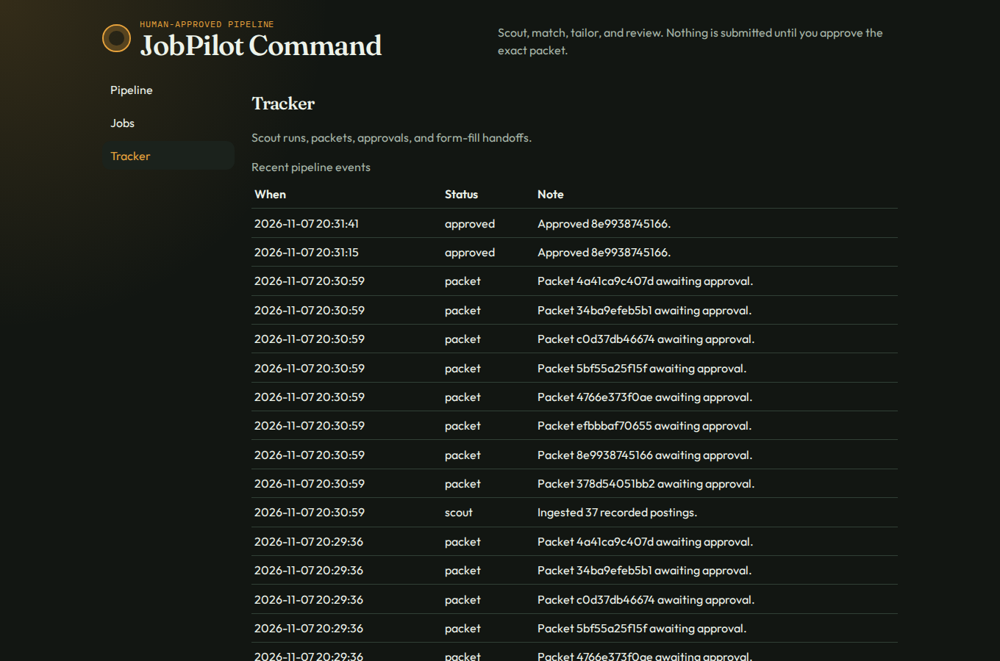

# JobPilot Command

JobPilot Command is a multi-agent job hunt that stops at a person. Scout reads public Greenhouse, Ashby, and Lever job boards. Matcher explains a fit score from a candidate facts file. Tailor drafts a resume bullet list, a cover letter, and common application answers that cite those facts. Reviewer drops anything the facts do not support, ignores instructions hidden in posting text, and leaves demographic questions blank. An application packet can be filled with Playwright, and it cannot be submitted without an approval token for that exact packet.

This repository is the portfolio project of [Gabriel Nadal](https://github.com/voxzyboxzy) and the tool his assistant runs on a Linux box. The candidate shipped in git is fictional. Real facts and resumes stay outside the commit history.



## Quickstart for real use

Requirements: Node.js 22.5 or newer.

```bash
git clone https://github.com/voxzyboxzy/jobpilot-command.git
cd jobpilot-command
npm install
npx playwright install chromium
cp examples/candidate.example.yaml candidate.local.yaml
```

`candidate.local.yaml` is gitignored. Edit it with real facts. Each fact needs a stable `id`. Put the resume PDF outside the repo or under a gitignored name such as `candidate.local.pdf`.

Point the config at those files. Either edit `jobpilot.config.yaml`:

```yaml
facts: candidate.local.yaml
resume: /home/you/Documents/resume.pdf
```

or export:

```bash
export JOBPILOT_FACTS="$PWD/candidate.local.yaml"
export JOBPILOT_RESUME="/home/you/Documents/resume.pdf"
```

The example facts file is synthetic (Alex Rivera in Tampa). Do not replace it with a real biography inside `examples/` and do not commit the local file.

Daily commands, JSON on stdout:

```bash
npm run jobpilot -- scout --json
npm run jobpilot -- rank --top 10 --json
npm run jobpilot -- packet <job-id> --json
npm run jobpilot -- approve <job-id> --by "Gabriel Nadal"
npm run jobpilot -- fill <job-id> --stop-before-submit --json
npm run jobpilot -- tracker --json
```

`scout` reads `config/watchlist.yaml` and calls the public board APIs. Postings are deduped in SQLite on `source + board + external id`. `first_seen_at` stays on the first insert. `rank` keeps remote or hybrid roles that look open to the US, including Florida, and that sit in the configured families: entry-level software, QA, automation/AI, IT or technical support, data, and Spanish-bilingual support. It drops postings that clearly require a degree with no equivalent-experience path, 3 or more years, a security clearance, or a LinkedIn profile. Ashby `isRemote: true` is treated as remote or hybrid unless `workplaceType` says otherwise.

A packet lists every field, the fact ids behind it, and a content hash. `approve` returns a token bound to that hash. Editing a field clears the token. `fill` types known Greenhouse, Ashby, and Lever fields, uploads the resume, writes a screenshot and a field report under `data/artifacts/`, and stops before submit. Unknown required questions, captchas, and unsupported layouts become a handoff (exit code 2). Submit is a separate flag and still checks the token:

```bash
npm run jobpilot -- fill <job-id> --submit --token <approval-token>
```

Exit codes: `0` ok, `1` error, `2` handoff, `3` submission blocked.

One-shot daily run (scout, score, refresh the top packets, do not approve or submit):

```bash
npm run jobpilot -- daily --json
```

Scheduler, 07:30 America/New_York:

```bash
npm run jobpilot -- schedule --print
```

That prints a `CRON_TZ=America/New_York` line you can install in crontab. `npm run jobpilot -- schedule` also prints the next run instant.

Add a board after you confirm the public JSON URL responds:

```bash
npm run jobpilot -- boards add --source greenhouse --token acme --company "Acme"
npm run jobpilot -- boards verify --json
```

Sources are `greenhouse`, `ashby`, and `lever`. Tokens are the public board slugs:

- `https://boards-api.greenhouse.io/v1/boards/{token}/jobs?content=true`
- `https://api.ashbyhq.com/posting-api/job-board/{token}?includeCompensation=true`
- `https://api.lever.co/v0/postings/{token}?mode=json`

The starter watchlist has 58 company tokens that returned HTTP 200 and a JSON jobs array on 2026-11-07.

Offline demo, using the recorded postings and the synthetic candidate, then the dashboard:

```bash
npm run build
npm run demo
```

Open `http://127.0.0.1:8787`. `npm run demo` seeds `data/demo/jobpilot.db` and serves the built UI.

### Optional model

The default is deterministic. No API key is read, and CI forces that path. To ask an OpenAI-compatible endpoint or Ollama for prose, set:

```bash
export JOBPILOT_LLM=openai          # or ollama
export JOBPILOT_LLM_BASE_URL=https://api.openai.com/v1
export JOBPILOT_LLM_MODEL=gpt-4o-mini
export JOBPILOT_LLM_API_KEY=...     # or OPENAI_API_KEY
```

Ollama's default base URL is `http://127.0.0.1:11434`. Posting text is wrapped as data and cannot change the system instructions. Reviewer still deletes claims that are not in the facts file. If the endpoint fails, the heuristic draft is used.

## Evals

`npm run eval` replays recorded postings, scores them, checks claims, drives the local mock ATS with Playwright, and tries to bypass approval. It does not use the network. The command exits non-zero if precision@10 drops below 0.70, a cleaned packet still has an unsupported claim, form accuracy is below 1, an approval attack succeeds, or an injection string leaks into a draft.

Measured on the synthetic candidate against `fixtures/recorded/` (37 postings saved from the live APIs on 2026-11-07, labeled by hand in `fixtures/recorded/labels.json`):

| Check | Result |
| --- | --- |
| Precision@10 | 8/10 = 0.80 |
| Eligible in the labeled set | 12 of 37 |
| Unsupported-claim rate | 0/117 = 0 |
| Residual unsupported claims after review | 0 |
| Planted unsupported claims removed | 2/2 |
| Form-field accuracy on the mock ATS | 27/27 = 1.00 |
| Approval bypasses | 0/4 |
| Injection cases leaked into a draft | 0/4 |

Precision@10 is the share of the top 10 eligible jobs whose human label is relevant. Eight of the twelve eligible recorded jobs are relevant, so 0.80 is the ceiling for this set. The two misses in the top 10 are a billing-support specialist and an implementation-engineer seat, both scored under the bilingual support roles. The raw report is `docs/eval-results.json`.

## Dashboard









The pipeline page counts jobs that reached Scout, Matcher, Tailor, and Reviewer. The job list shows the fit score and the fact ids behind each requirement. Packet review is where a person approves the hash. The tracker is the log of scouts, packets, approvals, and fill handoffs.

## Tests and CI

```bash
npm test
npm run eval
npm run typecheck
npm run build
```

Vitest currently runs 18 tests: eligibility, dedupe and first-seen dates, the state machine, ranking, fact citations, approval invalidation, the 07:30 New York schedule, the watchlist size, and the Playwright filler against the mock ATS (known fields, demographic questions left blank, captcha handoff, unknown-question handoff, submit blocked without a token, submit accepted with a token).

GitHub Actions (`.github/workflows/ci.yml`) installs Chromium and runs those commands on Node 22. The workflow has no live network calls. Recorded fixtures are the only postings CI sees.

## Live scout from this workspace

On 2026-11-07 a scout from this environment called all 58 starter boards. All 58 returned JSON. SQLite stored **8549** postings. After the remote/hybrid and US-or-Florida filters, **16** were eligible. The run is local to `data/`, which is gitignored, so the database is not in the commit. Re-run `npm run jobpilot -- scout --json` to refresh it. Counts move every day.

## Limitations and ethics

A person approves every packet. The filler does not press submit unless `--submit` is passed and the approval token still matches the packet hash. There is no background auto-submit.

Tailor may only say what a fact says, and it has to cite the fact id. Reviewer removes a sentence that does not quote those facts. Demographic questions (gender, race or ethnicity, veteran status, disability) are left blank on purpose. Salary is left blank unless a fact states it. Do not put a claim in the facts file that you cannot defend.

Posting text is untrusted data. Lines that tell the model to ignore instructions are recorded and are not treated as requirements.

The matcher is a transparent heuristic, not a prediction that someone will get an interview. It misses unusual location wording and it can over-exclude a posting whose degree or years requirement is phrased oddly. The form filler knows common labels on Greenhouse, Ashby, and Lever hosted pages. A custom question, a captcha, or a layout it does not recognize is a handoff, not a guess. Respect each employer's terms. The client uses the public JSON job boards, identifies itself, and is meant for one person's search, not bulk traffic.

The example candidate, example resume, and recorded eval labels are for the tool. They are not Gabriel's application.

## Layout

- `src/agents/` Scout, Matcher, Tailor, Reviewer, and the stage graph in `machine.ts`
- `src/sources/` Greenhouse, Ashby, and Lever normalizers
- `src/filters/eligibility.ts` workplace, location, degree, years, clearance, LinkedIn, role family
- `src/packet/approval.ts` content hash and HMAC approval token
- `src/fill/filler.ts` Playwright filler
- `src/mock/server.ts` local mock ATS used by tests and evals
- `web/` React dashboard
- `config/watchlist.yaml` starter boards
- `examples/candidate.example.yaml` synthetic facts
- `fixtures/recorded/` postings saved from the public APIs, plus hand labels

## License

MIT. Copyright (c) 2026 Gabriel Nadal.
